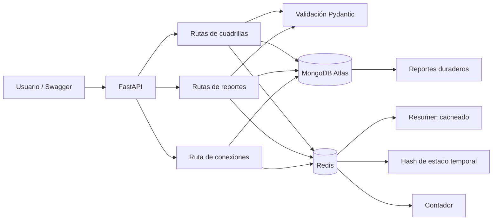

# API de infraestructura dañada · Caso 8

Proyecto final de Bases de Datos III: API para registrar reportes ciudadanos de infraestructura y consultar el estado de las cuadrillas de reparación.

## Arquitectura

- **MongoDB Atlas** es la fuente de verdad de los reportes. La base predeterminada es `infraestructura_alcaldia` y la colección es `reportes`.
- **Redis** almacena el resumen de barrios en caché, los estados temporales de cuadrillas y un contador de consultas.
- **FastAPI** expone la API y genera la documentación interactiva de Swagger.



## Estructura del proyecto

```text
.
├── API/
│   ├── main.py             # Crea la aplicación y registra los routers
│   ├── database.py         # Configuración y conexiones MongoDB/Redis
│   ├── utils.py            # Serialización y funciones compartidas
│   ├── routes/
│   │   ├── conection.py    # GET /ping y comprobación de conexiones
│   │   ├── reportes.py     # CRUD y resumen por barrios
│   │   └── cuadrillas.py   # Estado de cuadrillas y contador
│   └── schemas/
│       ├── reportes.py     # Modelos Pydantic para reportes
│       └── cuadrillas.py   # Modelo Pydantic de cuadrilla
├── cargar_datos.py         # Carga 30 reportes de prueba
├── requirements.txt
├── .env.example            # Plantilla sin credenciales reales
└── .gitignore
```

## Requisitos

- Python 3.10 o posterior.
- Una base de datos MongoDB Atlas accesible.
- Una instancia Redis accesible (por ejemplo, Redis Cloud).

## Instalación y configuración

Ejecuta estos comandos desde la **raíz del proyecto**. En PowerShell:

```powershell
python -m venv .venv
.\.venv\Scripts\Activate.ps1
python -m pip install -r requirements.txt
Copy-Item .env.example .env
```

En macOS/Linux:

```bash
python3 -m venv .venv
source .venv/bin/activate
python -m pip install -r requirements.txt
cp .env.example .env
```

Edita `.env` localmente y reemplaza los valores de ejemplo:

```env
MONGO_URI=mongodb+srv://<usuario>:<contraseña>@<cluster>/?retryWrites=true&w=majority
MONGO_DB=infraestructura_alcaldia
REDIS_URL=redis://<usuario>:<contraseña>@<host>:<puerto>
CACHE_TTL_SEGUNDOS=60
CUADRILLA_TTL_SEGUNDOS=300
```

Usa los valores y el esquema (`redis://` o `rediss://`) proporcionados por tu proveedor. Si una contraseña tiene caracteres especiales, deben codificarse para URL. **No publiques ni compartas `.env`**; `.gitignore` ya lo excluye. `.env.example` es solo una plantilla.

Las variables `MONGO_URI` y `REDIS_URL` son obligatorias. `MONGO_DB` usa `infraestructura_alcaldia` si no se define. Los TTL predeterminados son 60 segundos para la caché y 300 segundos para el estado de cuadrilla.

## Cargar datos de prueba

Desde la raíz, ejecuta:

```powershell
.\.venv\Scripts\python.exe .\cargar_datos.py
```

El script carga 30 reportes mediante operaciones *upsert* basadas en `codigo`: si el código existe, actualiza ese documento; si no, lo inserta. Por eso puede ejecutarse de nuevo sin crear duplicados. Al terminar informa cuántos documentos insertó, actualizó y el total de la colección.

## Iniciar la API

Desde la raíz del proyecto:

```powershell
.\.venv\Scripts\python.exe -m uvicorn API.main:app --reload
```

Con el entorno virtual activado también puedes usar:

```bash
python -m uvicorn API.main:app --reload
```

Usa `python -m uvicorn` para ejecutar Uvicorn desde el entorno virtual correcto. Abre:

- Swagger: <http://127.0.0.1:8000/docs>
- OpenAPI JSON: <http://127.0.0.1:8000/openapi.json>

Detén el servidor con `Ctrl+C`. Si cambias `.env`, reinícialo para que se creen de nuevo las conexiones con los valores actualizados.

## Endpoints

| Método y ruta | Base | Descripción y resultado relevante |
|---|---|---|
| `GET /ping` | MongoDB y Redis | Comprueba ambas conexiones; responde 503 si alguna falla. |
| `GET /reportes` | MongoDB | Lista reportes. Filtros opcionales: `estado`, `tipo_estructura`, `barrio`, `severidad_min`; `limite` va de 1 a 100 y por defecto es 20. |
| `GET /reportes/{reporte_id}` | MongoDB | Busca por ObjectId; 400 si el formato es inválido y 404 si no existe. |
| `POST /reportes` | MongoDB y Redis | Valida con Pydantic y crea (201); 422 por datos inválidos y 409 si el `codigo` ya existe. Invalida el resumen cacheado. |
| `PUT /reportes/{reporte_id}` | MongoDB y Redis | Actualiza solo los campos enviados; 400 si no hay campos, 404 si no existe. Invalida la caché. |
| `DELETE /reportes/{reporte_id}` | MongoDB y Redis | Elimina el reporte; 400 si el ID es inválido y 404 si no existe. Invalida la caché. |
| `GET /reportes/resumen/barrios` | MongoDB y Redis | Agrega reportes abiertos por barrio y devuelve `origen: "mongo"` o `origen: "redis"`. |
| `PUT /cuadrillas/{cuadrilla_id}/estado` | MongoDB y Redis | Guarda el hash de estado; si se envía `reporte_codigo`, comprueba que exista. |
| `GET /cuadrillas/{cuadrilla_id}/estado` | Redis | Devuelve estado y TTL; 404 si no existe o ya expiró. |
| `GET /cuadrillas` | Redis | Lista estados vigentes de cuadrillas. |
| `GET /estadisticas/consultas` | Redis | Devuelve el contador de consultas al resumen. |

### Ejemplo de reporte

```json
{
  "codigo": "REP-031",
  "tipo_estructura": "via",
  "descripcion": "Hundimiento del pavimento frente a la escuela",
  "barrio": "Cuba",
  "severidad": 4,
  "personas_afectadas": 80,
  "estado": "pendiente",
  "etiquetas": ["hundimiento", "pavimento"],
  "fotos": ["rep031_a.jpg"]
}
```

Los valores permitidos para `tipo_estructura` son `via`, `edificio`, `puente` y `anden`. Los estados son `pendiente`, `en_reparacion` y `resuelto`. `fecha_reporte` es opcional; si se omite, la API usa la fecha actual. `etiquetas` y `fotos` son arreglos de texto; las imágenes no se almacenan en MongoDB.

## Agregación por barrios

`GET /reportes/resumen/barrios` responde qué barrios concentran daños abiertos y cuántas personas afectan. El pipeline:

1. `$match`: conserva reportes `pendiente` o `en_reparacion`.
2. `$group`: agrupa por barrio y calcula cantidad de reportes, personas afectadas y severidad promedio/máxima.
3. `$sort`: ordena por severidad máxima y luego por personas afectadas, en orden descendente.
4. `$project`: presenta `barrio` en lugar del `_id` interno y redondea el promedio a un decimal.

## Redis: caché, cuadrillas y contador

| Clave | Estructura Redis | Uso | TTL |
|---|---|---|---|
| `cache:reporte:resumen_barrios` | String con JSON | Resultado del pipeline para lecturas repetidas. | 60 s predeterminados |
| `estado:cuadrilla:<id>` | Hash | Estado, reporte asociado opcional y hora de actualización. | 300 s predeterminados |
| `contador:reporte:consultas` | String numérico (`INCR`) | Cuenta consultas al resumen. | Sin TTL configurado |

El resumen sigue el patrón *cache-aside*: primero consulta Redis; si no encuentra el dato, ejecuta el pipeline en Mongo y almacena el resultado con TTL. POST, PUT y DELETE eliminan la clave de caché después de una modificación exitosa para evitar servir un resumen desactualizado. Si Redis está inaccesible al leer la caché, la ruta intenta responder desde Mongo.

Los estados de cuadrilla son temporales y se guardan en un hash individual. Al expirar el TTL, Redis elimina ese estado. Los reportes principales no se guardan en Redis.

## Índices y verificación

Al iniciar, la aplicación crea:

- Índice único en `codigo`.
- Índice en `estado`.
- Índice compuesto en `tipo_estructura` ascendente y `severidad` descendente.

Para inspeccionar el plan de una consulta en `mongosh`:

```javascript
db.reportes.find({
  tipo_estructura: "via",
  severidad: { $gte: 4 }
}).explain("executionStats")
```

Busca `IXSCAN` en `queryPlanner.winningPlan`. Con una colección pequeña, el optimizador puede preferir un escaneo completo aunque el índice exista.

## Prueba rápida en Swagger

1. Comprueba `GET /ping`.
2. Consulta `GET /reportes?limite=100` para listar los datos de prueba.
3. Crea un reporte con POST y usa el `_id` devuelto para probar GET, PUT y DELETE.
4. Consulta el resumen: la primera respuesta tras una caché fría debe indicar `origen: "mongo"`; una repetición debe indicar `origen: "redis"`.
5. Modifica un reporte y vuelve a consultar el resumen: debe recalcularse desde Mongo.
6. Guarda y consulta el estado de una cuadrilla; revisa el TTL retornado.

## Solución de problemas

- **`uvicorn` no se reconoce:** activa `.venv` o ejecuta `.\.venv\Scripts\python.exe -m uvicorn API.main:app --reload` desde la raíz.
- **`GET /reportes` devuelve una lista vacía:** ejecuta `cargar_datos.py` desde la raíz y confirma el total indicado por el script. Revisa que la API use el mismo `MONGO_URI` y `MONGO_DB`.
- **`GET /ping` indica error de MongoDB:** verifica acceso de red y la URI de Atlas en `.env`; no compartas esa URI.
- **Redis devuelve `AuthenticationError`:** comprueba usuario, contraseña y base de datos seleccionada en el proveedor.
- **Redis devuelve `ConnectionError`:** comprueba host, puerto, reglas de acceso de red y que la base esté activa. Reinicia Uvicorn después de editar `.env`.
- **Las cuadrillas devuelven 503:** Redis no está disponible para esa operación; revisa la conexión con `GET /ping`.

## Consideraciones de seguridad

Este es un prototipo académico y no implementa autenticación ni autorización de usuarios. No lo expongas públicamente con datos reales. En producción se deberían añadir controles de acceso, limitar los datos personales, proteger conexiones con TLS cuando corresponda y configurar credenciales con privilegios mínimos.
